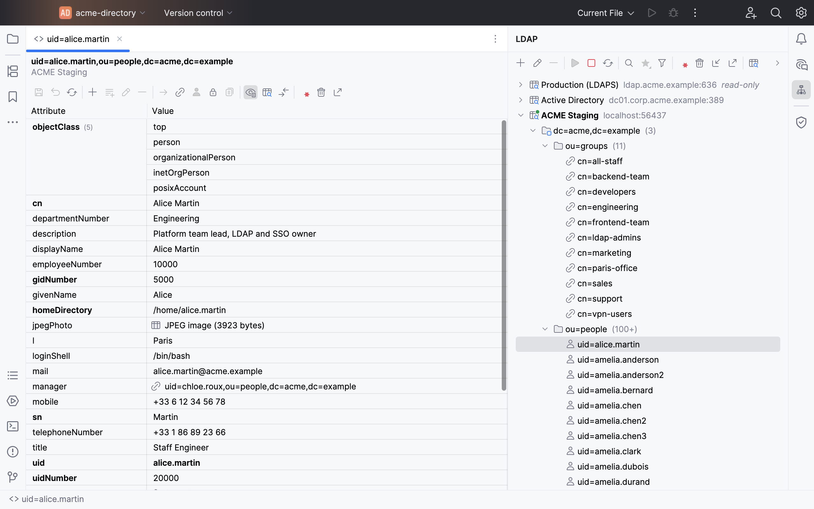
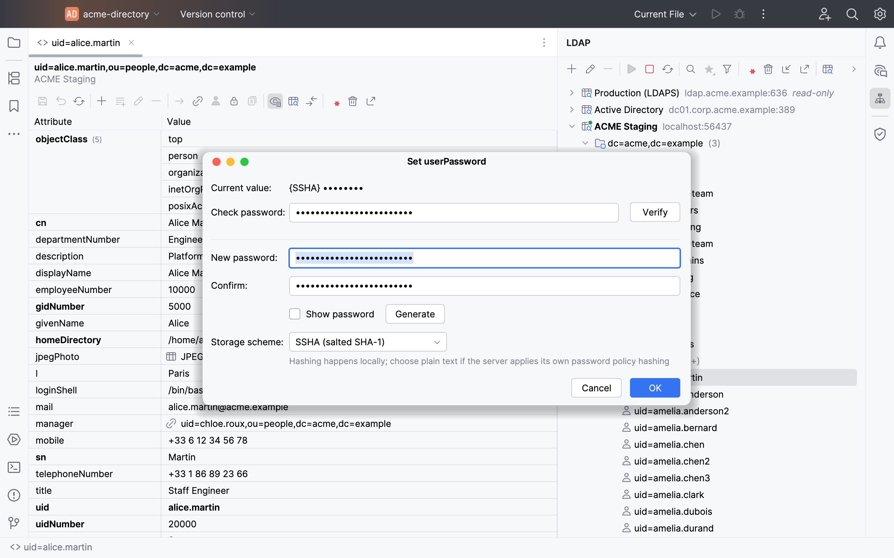
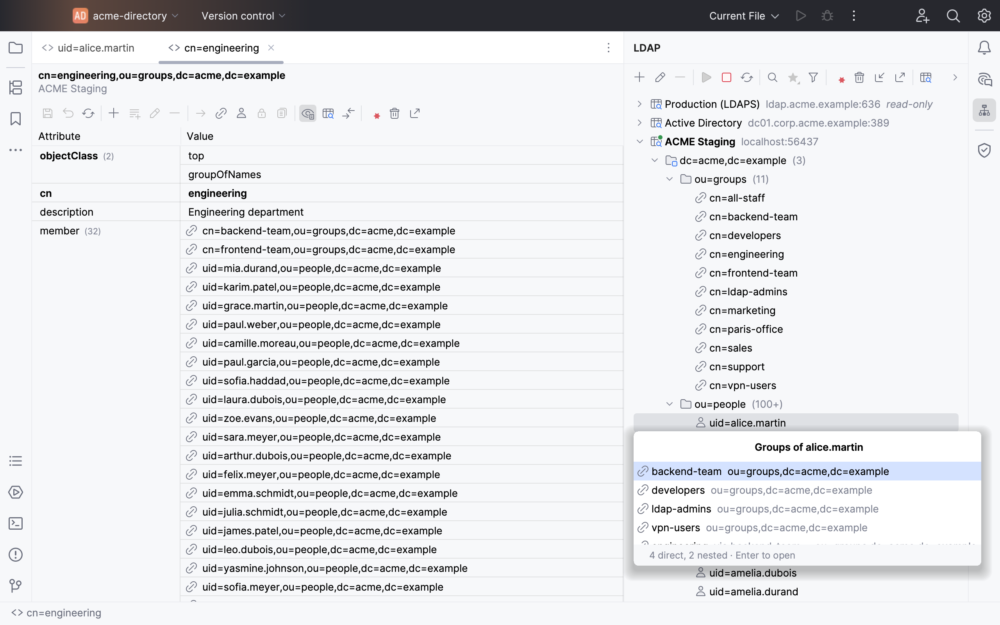
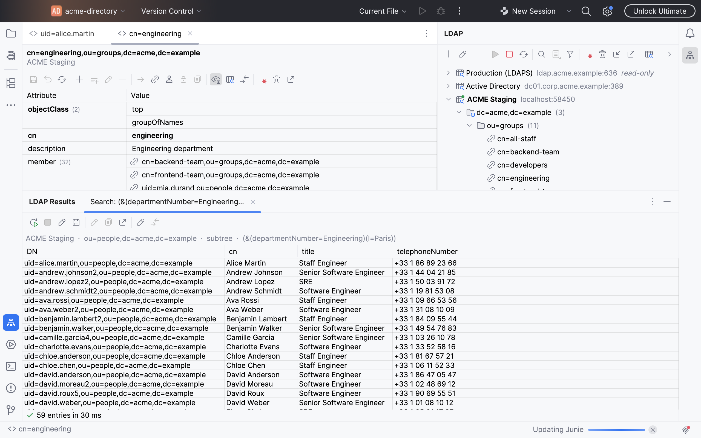
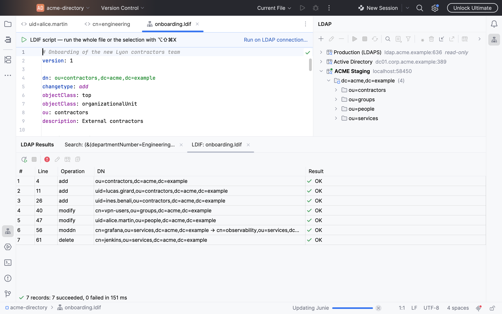
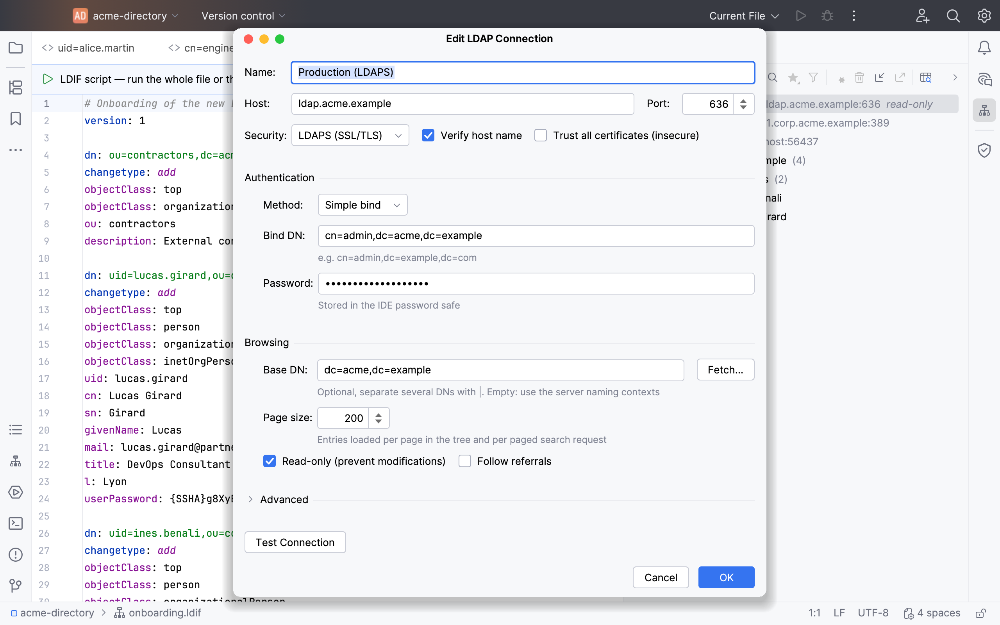
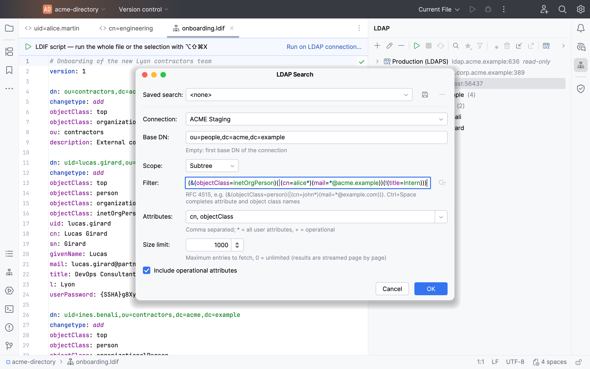
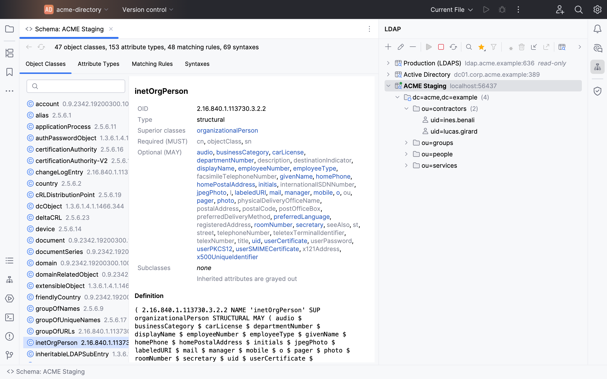
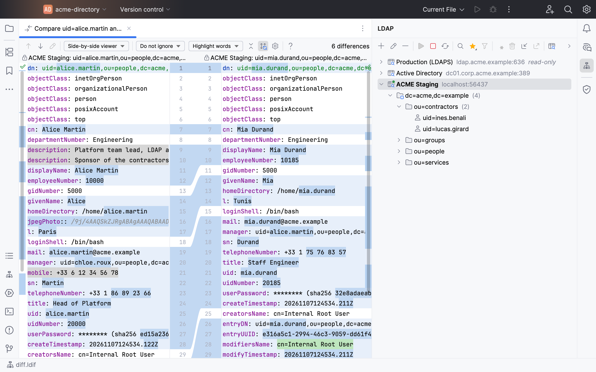
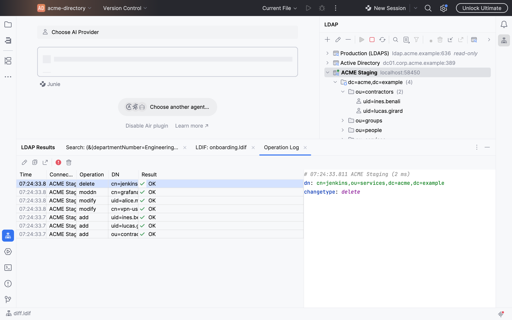

# LDAP Client for IntelliJ

A complete LDAP browser and editor for IntelliJ-based IDEs (IntelliJ IDEA, PyCharm, WebStorm, GoLand, … 2026.3 and later).
It works with any LDAPv3 server, such as OpenLDAP, Active Directory, 389 Directory Server or OpenDJ.

Browse very large directories, search, edit entries with schema-aware editors, and run LDIF scripts, all without leaving the IDE.
Every directory operation runs in the background, so the UI never freezes.



## Contents
- [Features](#features)
- [Getting started](#getting-started)
- [Keyboard shortcuts](#keyboard-shortcuts)
- [Settings](#settings)
- [Project structure](#project-structure)
- [Build & run](#build--run)
- [Publishing to JetBrains Marketplace](#publishing-to-jetbrains-marketplace)

## Features

### Connections
- Any number of connections, shown directly as roots of the **LDAP** tool window tree (like the Database tool window). Connected servers have a green dot and bold text.
- Reorder connections by dragging one onto another, or with **Move Up / Move Down** in the context menu.
- Plain LDAP, **LDAPS** or **StartTLS**. Hostname verification is optional, and *Trust all certificates* is available for test servers.
- Anonymous or simple bind. Passwords are kept in the IDE password safe, never in settings files.
- One or more base DNs, separated by `|`. When empty, the server's naming contexts are used, and **Fetch…** reads them from the root DSE.
- Tunable page size, connect and response timeouts, maximum pooled connections, and referral following.
- **Read-only** connections (marked *read-only* in the tree) disable every write action, which protects production servers.
- **Test Connection** checks the settings before you save them.

### Efficient tree navigation
- Children are fetched page by page with the Simple Paged Results control. A *Load more…* node appears when more remain, so containers with hundreds of thousands of entries open instantly.
- A cursor holds its connection only while it is active. After 2 minutes idle it releases the connection and resumes transparently later.
- **Filter Children…** sets a per-node child filter, for example `(uid=a*)`.
- Icons distinguish domains, organizational units, people and groups. The number of children is shown next to each node (`100+` while more pages remain).
- Double-click or press Enter on an entry to open it in the entry editor.

### Search
- **Search…** from the toolbar or a node's context menu. Options: base / one-level / subtree scope, attribute list, and size limit (0 = unlimited).
- The filter field has syntax highlighting and completes attribute and object class names from the server schema (Ctrl+Space).
- The last 20 filters are remembered. Searches can be **saved** (from the dialog or the results tab) and run again from the **Saved Searches** dropdown (list icon) of the LDAP toolbar, grouped by connection. Saving under an existing name asks before replacing it.
- Results stream into a spreadsheet-style table in a tab of the **LDAP Results** tool window (bottom). A header shows the connection, base, scope and filter. Stopping a search abandons it on the server.
- Running a saved search again reuses its tab, which is titled with the saved name. Running the same unsaved query also reuses its tab.
- On the results you can:
  - **Edit Search…** to change the query and run it again in the same tab, or **Save Search…**
  - **Open Entry** and **Copy DN**, and **Rerun** or **Stop** the search
  - **Export to LDIF…**
  - **Bulk Modify…**: add, replace or delete values of one attribute on the selected or all entries (writable connections only). After a preview, the generated LDIF script runs directly; you can also open it in an editor first.
  - **Compare Selected Entries** when exactly two rows are selected.

### Entry editor
- Spreadsheet-style grid, like the Database data editor (all plugin tables share this look). Multi-valued attributes look like a merged cell, with alternating shading per attribute and a stronger divider before operational attributes.
- Schema aware:
  - Required (MUST) attributes are shown in bold.
  - Attributes that the object classes do not allow are underlined in red.
  - Tooltips show the attribute description, syntax, single- or multi-valued flag and whether it is required or optional.
  - **Show in Schema** opens the attribute type in the schema browser.
- Edits stay pending and highlighted until you save; **Revert Changes** discards them. Everything is saved in a single modify request.
- **Change preview**: before saving, the LDIF modify request is shown, with password values masked. You can turn this off in *Settings | Tools | LDAP Client*.
- Custom value editors:
  - **Passwords**: hashed with {SSHA512}, {SSHA256}, {SSHA}, {SHA512}, {SHA256}, {SHA}, {SMD5} or {MD5}, sent as plain text (for servers that hash themselves), or set as Active Directory `unicodePwd`. A generator creates new passwords, and you can verify a password against the stored hash.
  - **Binary values**: hex dump, image preview (`jpegPhoto`), X.509 certificate details, `objectGUID` / `objectSid` decoding, and load from or save to a file.
  - **DN, integer, boolean and generalized time** values, each with validation.
- **Operational attributes** (`createTimestamp`, `modifiersName`, `entryUUID`, …) are hidden by default. Show them with the eye toggle in the toolbar.
- DN values (`member`, `memberOf`, `manager`, `seeAlso`, …) open with Ctrl+Click (⌘+Click on macOS), Ctrl+B (⌘B), or **Open Referenced Entry**. `memberUid` values are resolved to the user entry.

### Entry operations
Available from the tree context menu, the entry editor toolbar and the search results.
- **New Child Entry…**: write the entry as LDIF, or use **From Object Classes…** to generate a template from the schema. Choose the object classes in a searchable list; required attributes are prefilled to fill in, and optional ones are added as comments.
- **Duplicate Entry…** opens the New Entry dialog prefilled with a copy of the entry, with `-copy` appended to its RDN.
- **Rename Entry…** (modify DN).
- **Delete…**: a single entry, or a whole subtree. Subtrees use the subtree-delete control when the server supports it, and are otherwise deleted client-side, leaves first.
- **Copy / Move…** copies an entry or a whole subtree to another parent, on the same or another connection (for example from staging to production).
  - You choose what happens on conflicts (skip, update, fail) and whether to stop at the first error.
  - A move within one connection uses a single Modify DN request. Otherwise the source is deleted only if the copy fully succeeded.
- **Compare With…** shows two entries side by side in the IDE diff viewer, from the same or different servers. Attributes and values are sorted, and password values are replaced by a hash.
- **Copy DN**, plus **Copy Entry as LDIF** in the entry editor.

### Group membership
- **Show Groups…** lists the groups an entry belongs to:
  - direct groups via `member`, `uniqueMember` and `memberUid`
  - `memberOf` / `isMemberOf`
  - nested groups, shown "via" their intermediate group
- **Show Members…** on a group lists its members, including Active Directory ranged `member` values (more than 1500) and dynamic `groupOfURLs` members (`memberURL`).
- Both open in a speed-search popup: type to filter, then press Enter to open one or more entries.

### Account tools
**Account Status…** (padlock icon) is available on user entries. It detects the directory flavor and shows the relevant facts.

| Flavor | What is shown |
|---|---|
| Active Directory | `userAccountControl` flags, `lockoutTime`, `badPwdCount`, `pwdLastSet`, `accountExpires`, `lastLogonTimestamp`, and the domain's `maxPwdAge` / `lockoutDuration` |
| OpenLDAP ppolicy | `pwdAccountLockedTime`, `pwdFailureTime`, `pwdChangedTime`, `pwdReset`, and the applicable `pwdPolicy` (`pwdMaxAge`, `pwdLockoutDuration`) |
| 389 DS | `nsAccountLock`, `passwordExpirationTime`, `accountUnlockTime`, `passwordRetryCount` |

It summarizes whether the account is active, disabled, locked or has an expired password, and offers **Unlock**, **Disable / Enable** and **Require Password Change**. Each change is previewed as LDIF before it is sent. ppolicy changes use the Relax control when the server advertises it.

### Schema browser
- Open it with **Schema Browser** (database-schema icon) on a connection, or with **Show in Schema** in the entry editor.
- Four tabs: object classes, attribute types, matching rules and syntaxes. Each has a filter, and every item links to the related ones.
- An object class shows its type (structural, auxiliary, abstract), its superior classes and subclasses, and its required (MUST) and optional (MAY) attributes. Inherited attributes are grayed out.
- An attribute type shows its superior type, syntax, matching rules, single- or multi-valued flag and usage. It also lists its subtypes and the object classes that use it.
- Matching rules and syntaxes list the attribute types that use them.
- The raw schema definition is shown at the bottom.

### LDIF scripts
- Run a script against a connection. Supported: content records and `changetype: add / modify / delete / modrdn / moddn`, including controls.
  - From the browser: **Import / Run LDIF File…** in the tool window or the tree context menu. Large files are streamed, not loaded into memory.
  - From an editor: open a `.ldif` file (or a plain-text scratch, with a selection) and use the banner, the editor context menu, or **Ctrl+Alt+Shift+X** (⌘⌥⇧X on macOS). Unsaved text and selections are supported. The action is also in the Project view context menu.
- Options:
  - Continue after errors, or stop at the first one.
  - For records without a changetype: add, or add-or-replace existing entries.
  - Validate only (dry run).
- Results stream into a tab of the **LDAP Results** tool window with one row per record (line, operation, DN, result). You can show failures only, stop or re-run the script, open the entry, and double-click a row to jump to its line in the script.
- LDIF syntax highlighting.

### LDIF export
- Right-click an entry (or use the toolbar or the entry editor) and choose **Export LDIF…**.
- Scope: the entry only, its direct children, or the whole subtree. You can also set a filter and an attribute list.
- Exports contain normal attributes only, unless you tick *Include operational attributes* or list one explicitly.
- Results are streamed to disk with paging, so even very large subtrees use little memory. The export runs in the background and can be cancelled; a partial file is deleted.
- Full subtree exports are written parents-first, so the file can be re-imported directly.

### Operation log
- Every add, modify, delete and rename sent by the plugin is recorded with its time, connection, DN, result and LDIF. Password values are masked.
- Open it with the history icon in the LDAP toolbar. You can show failures only, open the entry, copy the LDIF, or **Export as LDIF Script…**.
- The last 1000 operations are kept in memory for the IDE session.

### Non-blocking by design
- All network I/O runs in Kotlin coroutines on background threads. The UI thread only renders results.
- Long operations (searches, exports, imports, subtree copies) show progress and can be cancelled. Cancelled searches are abandoned on the server.
- Connections are pooled per server and opened lazily on first use.

## Getting started
1. Install the plugin from the JetBrains Marketplace (*Settings | Plugins*), or from disk with `build/distributions/ldap-client-*.zip`.
2. Open the **LDAP** tool window (right side) and click **+** (*Add Connection…*).
3. Enter the host, port, security and bind credentials, then click **Test Connection**. Leave *Base DN* empty to use the server's naming contexts.
4. Expand the connection to browse, and double-click an entry to edit it.
5. Use **Search…** (magnifier icon) to query the directory. Results open in the **LDAP Results** tool window at the bottom.

## Keyboard shortcuts

| Action | Windows / Linux | macOS |
|---|---|---|
| Open the selected tree entry | Enter / double-click | Enter / double-click |
| Move the selected connection up / down | Ctrl+Shift+Up / Down | ⌘⇧↑ / ⌘⇧↓ |
| Save entry changes | Ctrl+S | ⌘S |
| Edit value | F2 / double-click | F2 / double-click |
| Delete value | Delete | ⌫ |
| Open referenced entry (DN value) | Ctrl+B / Ctrl+Click | ⌘B / ⌘+Click |
| Complete attribute / object class in a filter | Ctrl+Space | ⌃Space |
| Run LDIF script or selection | Ctrl+Alt+Shift+X | ⌘⌥⇧X |

## Settings
*Settings | Tools | LDAP Client*:
- **Preview changes before saving entries** (on by default).
- **Show operational attributes**. This is the same toggle as in the toolbar.
- **Default size limit** for searches (default 1000, 0 = unlimited).

Connections, saved searches and recent filters are stored in `ldapClient.xml` in the IDE configuration directory. Passwords are kept in the IDE password safe.

## Project structure
```
src/main/kotlin/com/mouradzouabi/ldapclient/
├── core/      LDAP logic with no UI: sessions, paged/async search, LDIF parsing and export, schema index,
│              password hashing, group membership, entry diff/templates, subtree copy, account tools
├── model/     persisted settings, connection configs, saved searches, events
├── service/   connection manager (pools), project service (coroutine scope), operation log
└── ui/        tool windows, tree, entry editor, search, LDIF, schema browser, dialogs, settings page
src/test/       unit tests against an in-memory UnboundID LDAP server
src/screenshots dev-only plugin that generates the Marketplace screenshots
```
Built on the [UnboundID LDAP SDK](https://github.com/pingidentity/ldapsdk) and the IntelliJ Platform Gradle Plugin 2.x.

## Build & run
```
./gradlew runIde        # start a sandbox IDE with the plugin
./gradlew test          # unit tests (in-memory LDAP server)
./gradlew buildPlugin   # build/distributions/ldap-client-*.zip
```
Requires JDK 25. Open the **LDAP** tool window (right side) and add a connection with **+**. Search results and LDIF runs open as tabs in the **LDAP Results** tool window (bottom), which appears when needed.

## Publishing to JetBrains Marketplace

1. **Sign the plugin** (once). Generate a key and a certificate, and keep both out of the repository:
   ```bash
   openssl genpkey -aes-256-cbc -algorithm RSA -out private_encrypted.pem -pkeyopt rsa_keygen_bits:4096
   openssl rsa -in private_encrypted.pem -out private.pem
   openssl req -key private.pem -new -x509 -days 3650 -out chain.crt
   export CERTIFICATE_CHAIN="$(cat chain.crt)" PRIVATE_KEY="$(cat private.pem)" PRIVATE_KEY_PASSWORD='…'
   ```
2. **Verify** compatibility with the recommended IDE versions: `./gradlew verifyPlugin`. This downloads several IDEs.
3. **First release (manual)**:
   - Run `./gradlew signPlugin`.
   - Upload `build/distributions/ldap-client-<version>-signed.zip` at https://plugins.jetbrains.com (*Upload plugin*). Choose a license (open-source licenses require a source code URL) and tags (e.g. *Database*, *Tools*).
   - New plugins are reviewed by JetBrains before they become visible.
4. **Next releases**:
   - Bump `pluginVersion` in `gradle.properties`. The Marketplace rejects duplicate versions.
   - Create a token under *My Tokens*, then run:
     ```bash
     PUBLISH_TOKEN=… ./gradlew publishPlugin
     ```

### Snapshot / pre-release channel

The release channel is derived from the version suffix:

| `pluginVersion`    | Channel                     |
|--------------------|-----------------------------|
| `1.1.0`            | default (everyone)          |
| `1.1.0-snapshot.1` | `snapshot`                  |
| `1.1.0-eap.2`      | `eap`                       |

For example: `./gradlew publishPlugin -PpluginVersion=1.1.0-snapshot.1`. Each snapshot needs a new number.

To receive snapshot builds, users add `https://plugins.jetbrains.com/plugins/snapshot/list` under *Settings → Plugins → ⚙ → Manage Plugin Repositories*.

### Screenshots

Screenshots are generated automatically against a fake in-memory directory (`dc=acme,dc=example`, about 2,400 entries):

```bash
./gradlew runIdeForScreenshots                             # Light theme
./gradlew runIdeForScreenshots -PscreenshotThemes=Light,Dark
```

An IDE window opens, goes through each scenario by itself, and closes after 1–2 minutes. Don't interact with it while it runs.
The PNGs (2560×1600) are written to `docs/screenshots/`. If a step fails, the error is in `docs/screenshots/driver-error.txt`.
Add `-PscreenshotsKeepOpen=true` to keep the IDE open afterwards.

The driver lives in the `screenshots` source set (`src/screenshots`). It runs as a separate dev-only plugin in its own sandbox and is never included in `buildPlugin`.

Upload the PNGs on the plugin page under **Edit → Media**, after the first upload. They must be at least 1200×760 px with the same aspect ratio. Use the default theme, and only demo data. A short YouTube video can be linked there too.

| | |
|---|---|
|  |  |
|  |  |
|  |  |
|  |  |
|  |  |
